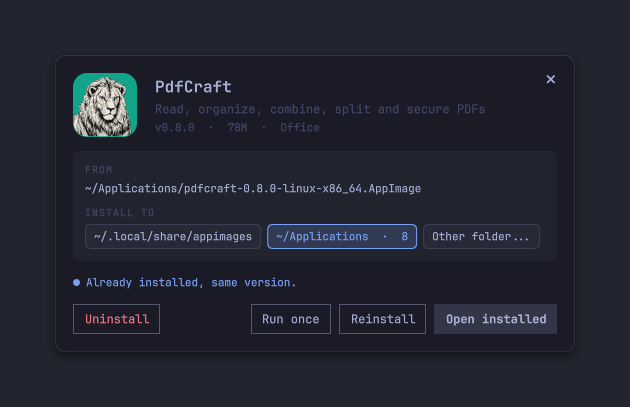
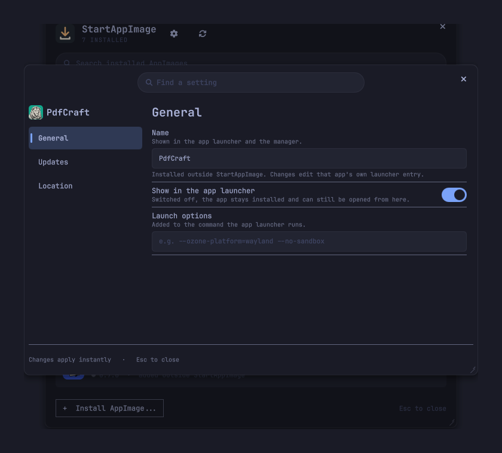

<p align="center">
  
</p>

<h1 align="center">StartAppImage</h1>

<p align="center">
  <b>AppImages, installed properly, for Omarchy.</b><br>
  Double-click an <code>.AppImage</code> to install it into your app launcher, then update, move,
  tweak and uninstall it from one themed window.
</p>

<p align="center">
  <a href="#install">Install</a> ·
  <a href="#tour">Tour</a> ·
  <a href="#configure">Configure</a> ·
  <a href="#commands">Commands</a> ·
  <a href="#security">Security</a> ·
  <a href="#update-and-remove">Update and remove</a> ·
  <a href="#contributing">Contributing</a>
</p>

## Install

```sh
omarchy plugin add https://github.com/bmaltais/StartAppImage.git --enable
```

That is all. A few seconds after the shell loads, a **setup card** offers three things, each on its own switch:

| Choice | What it does | Default |
|---|---|---|
| **App launcher entry** | Adds **StartAppImage** to your app launcher (SUPER + space) with its icon | On |
| **Open `.AppImage` files** | Makes StartAppImage the program that opens them, so a double-click shows the install card | On, replacing any app that opens them today (it is remembered, see below) |
| **Command line** | Links `~/.local/bin/startappimage` so you can use it in a terminal | On, unless that path is taken |

Nothing changes until you press **Apply**, and **Not now** leaves everything as it was. The card appears once.

- **Another app already opens AppImages?** The card names it ("Today these files open with *X*"). StartAppImage takes over by default and remembers *X*; switch the choice off later, from the card or with `setup --handler false`, and *X* gets the files back. Pick **Keep X** on the card to leave it in charge from the start.
- **Something else at `~/.local/bin/startappimage`?** It is left alone and the card says so.
- **Change your mind.** The gear button in the manager (or `omarchy-shell io.github.bmaltais.startappimage setup`) reopens the card with what is on right now.

Only your home folder is touched. Everything the plugin needs (`bash`, `curl`, `jq`, `notify-send`) comes with Omarchy.

Prefer the terminal? `startappimage setup --launcher true --handler true --cli true` does the same, and `startappimage integration` prints the current state as JSON. `register` and `unregister` still work.

## Tour

### Double-click to install



Opening an `.AppImage` from your file manager shows a small card instead of running it blindly: its icon, name, description, version and size, where the file comes from and where it will be kept.

- **A new app** offers **Install**, **Run once** or **Cancel**. Installing shows its progress, with the log one click away, then **Open** or **Done**.
- **An app that is already installed** says so, with both versions when they differ, and makes **Open installed** the main action. **Replace** (or **Reinstall**), **Run once** and **Uninstall** (after a confirmation) are beside it.
- **Where it goes.** Pick a folder AppImages already live in, such as `~/Applications`, or any other folder in your home. The folder you choose is remembered for the next install.

`Enter` takes the main action and `Esc` closes the card.

### The manager

Open **StartAppImage** from the app launcher, or bind a key to it (see [Commands](#commands)).

- **One row per app.** Its icon, name, version and where it came from, with a dot that turns to your accent colour when an update is waiting.
- **Open, settings, uninstall.** Three buttons on every row. Uninstall asks first. A click anywhere on a row highlights it.
- **Updates.** Apps installed from a GitHub release are checked every six hours, with a notification when something new is out. **Update** and **Update all** appear when there is something to update.
- **Add from anywhere.** **Add AppImage…** takes a file path, a download URL or `github:owner/repo`.
- **Apps installed by something else.** Any launcher entry that starts an `.AppImage` is adopted and tagged `EXTERNAL`, so apps put there by another launcher are listed too. You can open, configure and uninstall them like the rest. Uninstalling an external app deletes its file, so the confirmation asks "Delete the app?". StartAppImage does not update them unless you give them an update source.
- **Search and keyboard.** Type to search. `Up` and `Down` move, `Enter` opens, `Ctrl+U` updates, `Delete` uninstalls and `Esc` clears the search, then closes.

### Per-app settings



The cog on a row opens that app's settings. Only what you change is applied.

### Colours

Colours, fonts and corner radius follow the current Omarchy theme live.

## Configure

| Setting | What it does |
|---|---|
| **Name** | The name shown in the app launcher |
| **Location** | Moves the AppImage to another folder in your home. The launcher entry follows |
| **Launch options** | Extra arguments added to the launcher command, for instance `--ozone-platform=wayland --no-sandbox` |
| **Update source** | A GitHub `owner/repo` (a repository URL works too) whose releases are checked for updates. Empty means no updates |
| **In the app launcher** | Show or hide the app in the launcher without uninstalling it |

Each app is recorded in `~/.local/share/startappimage/<app>.env`, and the folder used for new installs in `~/.config/startappimage/config`. Every app remembers where its file is, so changing the default folder never breaks the apps you already installed.

## Commands

Run these with `omarchy-shell io.github.bmaltais.startappimage <command>`, for instance from a key binding:

| Command | Does |
|---|---|
| `open` | Shows or hides the manager |
| `install FILE` | Shows the install card for a file |
| `settings APP` | Opens an app's settings |
| `check` | Checks for updates now |
| `close` | Closes the window |

The command line works on its own too:

| Command | Does |
|---|---|
| `startappimage add FILE\|URL\|github:owner/repo [NAME] [--dir FOLDER]` | Installs an AppImage |
| `startappimage list [--json]` | Lists installed apps |
| `startappimage check [--json]`, `update [APP]` | Looks for updates, installs them |
| `startappimage config APP`, `set APP …` | Reads or changes an app's settings (`--name`, `--dir`, `--args`, `--source`, `--hidden`) |
| `startappimage setup [--launcher B] [--handler B] [--cli B]`, `integration` | Switches the launcher entry, file handler and command-line link on or off (`B` is `true` or `false`), or prints which are on |
| `startappimage remove APP` | Uninstalls an app and everything that was created for it |
| `startappimage run FILE\|APP` | Runs a file, or an installed app by name |
| `startappimage info FILE`, `locations` | Prints an AppImage's details, or the known install folders, as JSON |
| `startappimage register`, `unregister` | Sets or clears StartAppImage as the handler for `.AppImage` files |

Without the plugin loaded, opening an `.AppImage` falls back to a simple picker.

## Security

Plugins run unsandboxed, so here is what this one does.

- **Reading an AppImage runs it.** To show the name and icon, the file is run once with `--appimage-extract`, which unpacks a few files. Only open AppImages you trust, as you would before running them.
- **Downloads** use `curl` over the address you give. Updates from GitHub are not checked against a published digest, so only add update sources you trust.
- **Files** are only created, moved or deleted inside your home folder. Install and move folders outside it are refused, and so is deleting anything that is not an `.AppImage`.
- **Nothing is installed system-wide.** There is no `sudo` and no background service of its own: updates are checked by a timer inside the shell.

## Update and remove

```sh
omarchy plugin update io.github.bmaltais.startappimage --yes && omarchy restart shell
```

Your apps and settings are kept: they live in your home folder, not in the plugin folder.

To remove it, uninstall the apps you no longer want from the manager first, then:

```sh
~/.config/omarchy/plugins/io.github.bmaltais.startappimage/bin/startappimage unregister
omarchy plugin remove io.github.bmaltais.startappimage
```

`unregister` switches off all three setup choices: it removes the launcher entry and icon, gives the file-type association back to the app that had it, and deletes the `~/.local/bin/startappimage` link if it is ours. Apps you installed stay installed and keep working.

## A different take

[AppImage for Omarchy](https://github.com/glasschan/appimage-for-omarchy) is another AppImage manager for the Omarchy bar, with more update sources and checksum-verified updates. StartAppImage is smaller and is built around the double-click install card, per-app settings and a plain shell-script backend.

## Contributing

See [CONTRIBUTING.md](CONTRIBUTING.md) for the layout and the development install.

## License

MIT
